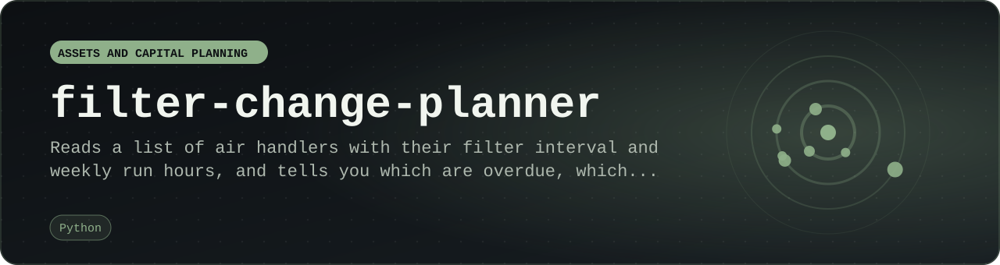
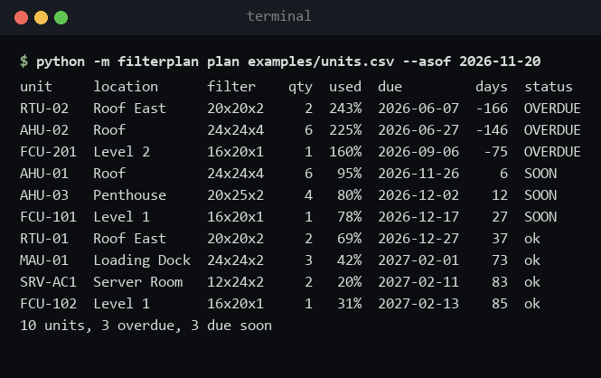

<p align="center"></p>

# filter-change-planner

Air filters wear out with run hours, not with the calendar. A unit that runs around the clock needs new filters sooner than one that runs 40 hours a week. This tool reads a list of air handlers with their filter interval and weekly run hours, and tells you which are overdue, which are due soon and what to buy.



## What it is for

Facility coordinators and HVAC technicians often change filters on a fixed quarterly route. That wastes filters on lightly used units and leaves heavily used units clogged. Use this planner to turn a simple unit list into a schedule sorted by due date and a purchase list by filter size. All sample units are invented.

## Install

```
git clone https://github.com/yassine2med/filter-change-planner
cd filter-change-planner && pip install -r requirements.txt
```

## How to use

| I want to | Command |
|---|---|
| Schedule from a date, sorted by due date | `PYTHONPATH=src python -m filterplan plan examples/units.csv --asof 2026-11-20` |
| Count units due within 14 days as SOON | `PYTHONPATH=src python -m filterplan plan examples/units.csv --asof 2026-11-20 --soon 14` |
| Exit 1 if any unit is overdue (for a script) | `PYTHONPATH=src python -m filterplan plan examples/units.csv --asof 2026-11-20 --fail-overdue` |
| Filters to buy for the next 30 days | `PYTHONPATH=src python -m filterplan order examples/units.csv --asof 2026-11-20 --within 30` |
| List rows that cannot be used | `PYTHONPATH=src python -m filterplan check examples/units_with_errors.csv` |
| Show help | `PYTHONPATH=src python -m filterplan --help` |

Example:

```
PYTHONPATH=src python -m filterplan plan examples/units.csv --asof 2026-11-20
```

Output:

```
unit     location      filter    qty  used  due         days  status
RTU-02   Roof East     20x20x2     2  243%  2026-06-07  -166  OVERDUE
AHU-02   Roof          24x24x4     6  225%  2026-06-27  -146  OVERDUE
FCU-201  Level 2       16x20x1     1  160%  2026-09-06   -75  OVERDUE
AHU-01   Roof          24x24x4     6   95%  2026-11-26     6  SOON
AHU-03   Penthouse     20x25x2     4   80%  2026-12-02    12  SOON
FCU-101  Level 1       16x20x1     1   78%  2026-12-17    27  SOON
RTU-01   Roof East     20x20x2     2   69%  2026-12-27    37  ok
MAU-01   Loading Dock  24x24x2     3   42%  2027-02-01    73  ok
SRV-AC1  Server Room   12x24x2     2   20%  2027-02-11    83  ok
FCU-102  Level 1       16x20x1     1   31%  2027-02-13    85  ok
10 units, 3 overdue, 3 due soon
```

Run the tests with `python -m pytest -q`.

## How it works

1. Each row of the CSV is one unit: filter size and quantity, the change interval in run hours, weekly run hours and the date of the last change.
2. Run hours used so far are estimated as weeks since the last change times weekly run hours.
3. The due date is the last change date plus interval hours divided by weekly run hours.
4. Status is OVERDUE when the due date has passed, SOON when it falls within `--soon` days (default 30), otherwise ok.
5. `order` adds up the quantity per filter size for units that are overdue or due within `--within` days (default 60).
6. Rows with a bad quantity, hours, date or duplicate unit are skipped and named.

## Limits

- Weekly run hours are an estimate; it does not read hour meters or the building system.
- It assumes the run pattern stays the same until the due date.
- Change a filter early if differential pressure or visible loading says so; this plan does not measure it.

## License

MIT. Yassine Emhamed, 2026.
